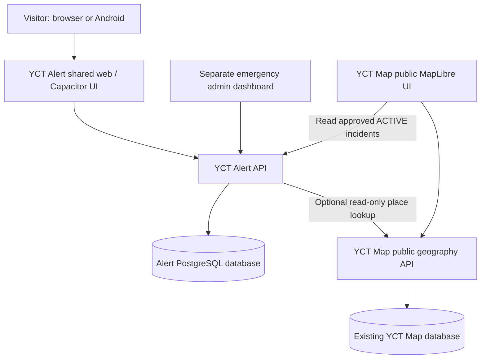

# YCT Map + YCT Alert
## Project Context and Integration Brief

**Version:** 0.1 (foundation document)  
**Date:** 24 October 2026  
**Audience:** Project owner, collaborators, software builders and AI coding agents  
**Scope:** Explain the existing YCT Map, the proposed YCT Alert, and how they should integrate. **This is not the build roadmap or final API specification.**

> **Evidence rule:** The description of YCT Map below is based on prior project discussions and development reports shared by the owner, **not an independent inspection of the latest source code**. Confirm exact files, models, routes and deployments against the current repository before implementation. In this brief, **Existing (reported)** means described as implemented on YCT Map; **Agreed** means a design direction chosen for YCT Alert; and **Proposed** means not yet implemented or formally specified.

---

## 1. Executive summary

**YCT Map** is an existing browser-based campus mapping and pedestrian-navigation application serving Yaba College of Technology (YABATECH), Lagos. It provides place discovery, interactive mapping, location-aware pedestrian routes and administrative tools for maintaining campus geography.

**YCT Alert** is a **new, independent campus incident-reporting platform**. Students, staff and visitors will be able to submit potential incident reports without creating accounts, either on a public mobile-friendly website or an Android application built with Capacitor. Authorized administrators will review, approve, reject and resolve incidents. Related reports can corroborate a possible incident but never automatically verify it.

The governing principle is: **YCT Map owns campus geography; YCT Alert owns incident reports and incident status.** They communicate through small versioned HTTP APIs, never a shared database or YCT Map's internal routing code. Each must remain useful when the other is unavailable.

## 2. YCT Map: current project (existing, reported)

### 2.1 Purpose, users and platform

- A dedicated, mobile-friendly web application helping campus visitors, students and staff locate destinations and navigate pedestrian walkways.
- Public users can explore the map without a general visitor account; restricted administration/editor tools use separate access controls.
- An **independent campus navigation initiative**: institutional ownership or official endorsement must not be assumed.
- Reported production address: `https://yct-map.onrender.com` (verify current deployment before use).

### 2.2 Technology

| Layer | Reported implementation |
|---|---|
| Backend / rendered website | Django (Python), server-rendered templates |
| Data | PostgreSQL on Neon |
| Mapping | MapLibre with OpenFreeMap basemap resources |
| Routing | Structured walkway graph with A* route computation |
| Web delivery | Render free service; Gunicorn and WhiteNoise |
| Device features | Browser geolocation and orientation/heading where supported |

### 2.3 Existing capabilities described in project discussions

1. Search and browse campus destinations and categories.
2. View mapped places, entrance anchors and available room/floor/wing arrival notes.
3. Generate pedestrian routes on the mapped walking network.
4. Show a user's live position and heading, subject to permission, accuracy and sensor constraints.
5. Administer walkable nodes/segments, place data and network connectivity.
6. Capture path-survey evidence and review/verify campus paths and entrance data over time.
7. Accept community map corrections/issues where supported by the public UI.
8. Provide an **About YCT Map** entry within the public Menu (reported implemented and tested).

### 2.4 Constraints and integration safeguards

- Do **not** claim all campus paths or entrances are fully field-verified. Published, reviewed and field-verified statuses may differ; inspect actual data semantics.
- Avoid changing existing A* routing, entrance matching, GPS filtering, heading logic, editor or Path Survey workflows during Alert V1 integration.
- The Render free backend may cold-start or be unavailable. Alert must not depend on Map availability before a visitor can report an incident.
- Existing public Map APIs have **not been audited for this brief**. Proposed endpoint paths later in this document are not claims of deployed endpoints.
- Mobile web experience already exists; converting YCT Map itself to a full Capacitor client is a **separate future project**, not part of YCT Alert V1.

## 3. YCT Alert: agreed new product direction

### 3.1 Core purpose

Allow the campus community to report potential emergencies and hazards, consolidate related submissions for authorized review, and publish safe information about approved active incidents. Example categories may include medical situations, fire/smoke, security events, accidents and other hazards; final categories need approval.

### 3.2 Independence and distribution (agreed)

- **Separate repository, backend, database, hosting and emergency-admin accounts** from YCT Map.
- A **single buildable web frontend** supporting a public browser experience **and Capacitor Android packaging from the outset**; Android first, iOS only if later authorized.
- A separate browser-based administrative dashboard; admin functions do not need to be packaged into the public mobile app.
- No public registration or sign-in required to submit incident reports.
- Keep the frontend self-contained and buildable into assets for Capacitor; do not depend on production-only remote page embedding as the core application architecture.
- Suggested but unapproved choices include a TypeScript/Vite frontend and an API + PostgreSQL backend. Exact frameworks and hosting are to be selected in the subsequent roadmap.

### 3.3 Basic public reporting workflow

1. Choose incident category.
2. Set **incident location** by optional device GPS, selecting a campus location or entering a manual point/description.
3. Give a short incident description and any appropriately optional contact information.
4. Submit; show **received** only after confirmed server acknowledgement.

A reporter's device location is not necessarily where an incident occurred. GPS permission denial must not block reporting. Offline or failed submissions must not appear as successfully delivered.

### 3.4 Reports, incidents, duplicates and lifecycle

- **IncidentReport** represents one submitted account. Preserve accepted raw submissions under a defined retention and privacy policy.
- **Incident** is an administratively managed event that can relate to many IncidentReports.
- Suggest matches using category compatibility, geographic proximity, temporal proximity and optional YCT place identity. An example starting hypothesis is about **50 metres within 15 minutes**, not a final rule.
- Distinguish true repeated-click retries (using idempotency keys) from different corroborating reports. Report counts are not verified unique-person counts.
- Concurrent submissions and incorrect automatic groupings must be handled safely; administrators need review and correction procedures.

**Proposed lifecycle:** `PENDING -> ACTIVE -> RESOLVED`, or `PENDING -> REJECTED`. Only authorized Alert administrators can approve/activate, reject or resolve incidents. Multiple reports alone must **never** turn an incident ACTIVE.

### 3.5 Safety, access and operational limits

- Separate authenticated Alert administrators; server-enforced authorization for all moderation and state changes.
- Validate coordinates, categories, descriptions and allowed transitions. Require modest rate limiting, size limits, idempotency, security logging and administrator action records.
- Private reporter details, raw report text and internal review comments must **not** appear in public incident feeds.
- Clearly distinguish *report received*, *reviewed*, *approved for public display* and *response dispatched*. The last state must not be claimed unless an authorized real response process actually exists.
- Test reports must be separated from production public alerts. Do not display simulated fires or accidents as real incidents.
- Present verified emergency contacts and escalation advice when authorized. Until a real staffed response arrangement is established, describe Alert as a **reporting pilot, not an emergency dispatch service**.
- A free backend may be useful for prototypes but cannot be assumed sufficiently available for life-safety operations; evaluate uptime, staffing, monitoring and failover before a real launch.

## 4. Responsibilities and ownership boundaries

| Responsibility | YCT Map | YCT Alert |
|---|---|---|
| Canonical place names / locations / entrances | Owns | Reads selected public place data when available |
| Pedestrian network / A* / route guidance | Owns | Does not modify |
| Incident reports and attachments (if approved) | Does not own | Owns |
| Incident review / public activation / resolution | Does not decide | Owns |
| Public incident markers | Displays approved safe feed only | Publishes approved feed |
| Administrators | Existing map admin/editor users | Separate emergency administrators |
| Data storage | Existing Map PostgreSQL | Distinct Alert database |
| Outage | Map continues if Alert fails | Reporting continues if Map fails |

**Prohibited integration shortcuts:** shared tables, direct cross-database foreign keys, direct writes from Alert into Map data, sharing authentication secrets, and injecting emergency logic into Map's A* routing engine as part of V1.

## 5. Proposed integration architecture

### 5.1 Geography from YCT Map to YCT Alert

**Proposed endpoints, not yet verified or implemented:**

- `GET /api/v1/places/`: discover public, canonical campus places; search/filter as appropriate.
- `GET /api/v1/places/{id}/`: get safe place identity, name and coordinates.
- Optionally `GET /api/v1/places/nearby/` or a limited public entrance endpoint, **only if a clear user need exists**.

YCT Alert may store a YCT Map place ID as a plain **external reference** (for example `yct_place_id`), with a copied short label and the reporter's incident point/description as an independent fallback. No cross-database foreign key. Map's ID stability, retired places and coordinate convention must be specified.

A report must be possible **without successfully calling YCT Map**. A visitor can supply manual incident-location information, with validation, when Map is sleeping or unavailable.

### 5.2 Active incidents from YCT Alert to YCT Map

**Proposed endpoint, not yet implemented:**

- `GET /api/v1/incidents/active/`: safe details of only administrator-approved ACTIVE incidents.

Candidate public fields: public incident ID, category, generalized safe description, safe geographic point, public status, publication time and last public update. Do **not** expose reporter identity, contact details, raw private submissions or moderation notes.

YCT Map would implement only a small, independent MapLibre marker layer, with an optional link to the public Alert reporting site. Do not change the routing engine or automatically route around hazards in V1. Display wording must not equate administrative publication with independent on-the-ground verification.

### 5.3 Contract requirements before building

Specify: actual endpoint paths; request/response schema; IDs; longitude/latitude ordering; time zones; pagination; cache and freshness rules; allowed public fields; versioning; HTTP error responses; CORS; rate limits; authentication for privileged actions; outages/retries; and integration tests. First audit existing Map APIs to avoid creating redundant endpoints.

## 6. Failure and degraded-mode design

| Situation | Required behaviour |
|---|---|
| YCT Map is down or cold-starting | Alert still takes reports via manual location entry; place lookup is optional. |
| YCT Alert is down | Map navigation/search/routing still work; incident layer handles unavailable/stale information clearly. |
| Network drops while submitting | Do not show server receipt; retain an unsent draft if possible and provide an explicit retry path. |
| Multiple rapid submission attempts | Idempotent retry behaviour; do not discard independent corroborating reports. |
| GPS denied or inaccurate | Manual incident-place selection or description remains available. |
| Many similar reports in a short time | Safe concurrent matching, no automatic verification or activation. |
| Administrator unavailable | Incident remains pending; no invented claim of monitoring or response. |
| Simulated test incident | Must not reach the real public incident feed or YCT Map. |

## 7. Explicit YCT Alert V1 non-goals

1. Replacing campus emergency lines, 24/7 dispatch or institutional response systems.
2. Altering YCT Map's A*, GPS filter, entrance matching, route progress or survey tools.
3. Automatically routing users away from active incident markers (possible V2 investigation).
4. Requiring users to register or install Android software before making a report.
5. Combining the Map and Alert databases, administrator identities or repositories.
6. Auto-approving incidents based on how many similar reports arrive.
7. Continuous background GPS tracking of reporters.
8. An immediate iOS release, sophisticated automated credibility scoring or heavy infrastructure not justified by V1 needs.

## 8. Agent and collaboration safeguards

- Treat this as a **planning foundation**, not a coding authorization or finished architecture contract.
- Read agreed product rules and API contracts before editing either application.
- Use small, reviewable tasks and separate branches/worktrees where multiple builders contribute.
- Complete an early end-to-end *test-only vertical slice*: web/Android report -> backend -> database -> admin review -> approved test marker. Never mix simulated data into a real public emergency feed.
- Validate on a physical Android device and in a browser. Passing frontend tests alone is not sufficient evidence of native permissions or submission behaviour.
- Keep dev, test and production database credentials isolated; do not seed/reset production, migrate destructively, deploy or commit without owner approval.
- Require agents to report changed files, actual test commands/results, device checks, unresolved risks and any deviation from the specification. Never claim blocked tests have passed.

## 9. Decisions already agreed and decisions still open

### Agreed

- Separate Map and Alert products; Map owns geography and Alert owns incidents.
- Anonymous public incident reporting, separate authenticated emergency administrators.
- Android-first Capacitor app built alongside a functional browser reporting application.
- Incident/report distinction and duplicate-aware matching without automatic public approval.
- Read-only, minimal integration; failure isolation; no V1 modifications to Map route computation.
- Conservative initial infrastructure cost, without promises of emergency-grade free hosting.

### Open / requiring evidence

- Latest YCT Map repository and actual public API availability; stable place identifiers and data-quality states.
- Alert frontend/backend stack, production hosting, availability requirements, cost and backups.
- Incident categories, report fields, retention period, optional contact/attachments and privacy notice.
- Matching thresholds, false-merge correction and moderator audit policy.
- Who is authorized to review incidents, official campus emergency contact details, working hours, response/escalation responsibility and institutional approvals.
- Exact API and incident-state contracts, geospatial precision and public-data minimization.
- Notification strategy (if any), Android package name/signing ownership and distribution plan.
- iOS scope, pilot test group, operations/monitoring responsibilities and post-launch maintenance.

## 10. What would help before the next roadmap and ZIP

**Nothing further is required to use this first brief.** For the next, implementation-ready documentation package, these inputs would be especially useful:

1. **Latest YCT Map repository or read-only code snapshot**: project brief, URLs, models, implemented location/search APIs, frontend map entry points, routing interface and relevant tests. Omit `.env` and all secrets.
2. **Deployment summary**: backend, domain, database and hosting/provider relationships, without credentials.
3. **Operational details**: who will review incidents, verified emergency contacts, pilot versus official institutional status, and any approved escalation arrangements.
4. **V1 feature decisions**: reporting categories, contact/attachment policy, notifications, public incident history and desired admin scope.
5. **Mobile distribution decision**: development APK, internal pilot APK, Play Store later, and ownership of app identity/signing keys.

Where those inputs are absent, label the assumptions and required validation work rather than making up implementation details.

## 11. Next deliverable — separate project-planning ZIP (not created here)

The next phase should produce a versioned **YCT Alert V1 Build Roadmap and Starter Documentation** ZIP containing, at minimum:

- `README.md` and a decision log
- `PRODUCT_SPEC.md` (requirements, personas, V1/non-goals)
- `ARCHITECTURE.md` and deployment/environment design
- `DATA_MODEL_AND_INCIDENT_RULES.md` (lifecycle, matching, integrity)
- `API_CONTRACT.md` and a focused `YCT_MAP_INTEGRATION.md`
- `MOBILE_CAPACITOR_PLAN.md` and browser/Android compatibility guidance
- `ADMIN_WORKFLOWS.md` and operational/safety/privacy requirements
- `BUILD_ROADMAP.md` with milestones, dependencies and acceptance gates
- `TEST_PLAN.md` and release-readiness checklist
- Root `AGENTS.md` plus handoff instructions for supporting builders
- `OPEN_QUESTIONS.md` and any diagrams needed to make the above unambiguous

The roadmap must distinguish implemented code from proposals, and avoid making promises about emergency response without operational authorization.

---

> **Foundational rule:** YCT Map is the source of truth for campus geography and pedestrian navigation. YCT Alert is the independent source of truth for submitted reports and managed incidents. Integrate through limited, documented public APIs with graceful failure boundaries. Preserve YCT Map's working navigation system.
