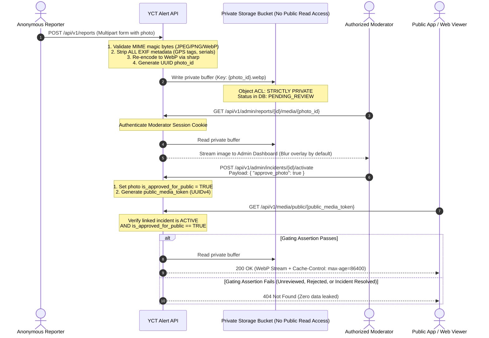
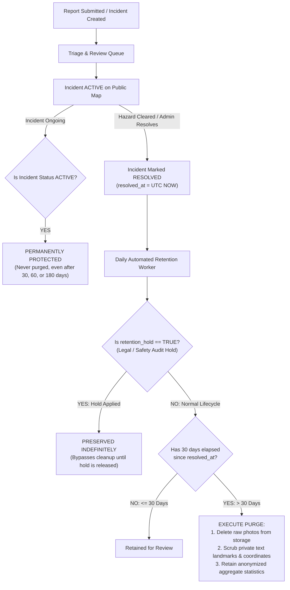
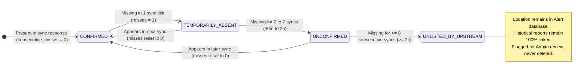
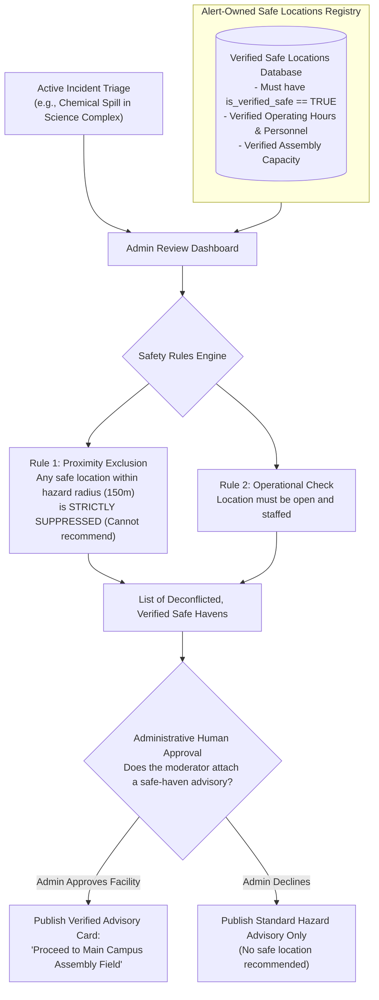

# YCT ALERT — PHASE 0.2: FOUNDATION RECONCILIATION & G0 DECISION REGISTER

**Document Version:** 0.2-FINAL  
**Date:** 3 November 2026  
**Status:** Approved Architectural Baseline & Gate G0 Decision Register  
**System:** YCT Alert (Campus Incident Reporting & Public Safety Platform)  
**Authoritative Reference For:** Engineering, Architecture, and Delivery Gates G0–G5  

---

## 1. Executive Summary & Resolution of Decisions

This document represents the reconciled technical foundation and architectural decisions for **YCT Alert** following owner reviews. All foundational operational and security questions have been resolved:

* **[RESOLVED] Super-Admin Identity (D-13 / Q-02):** Locked to **`ALERTadmin`**. Bootstrapped via a one-time secure local CLI script storing an Argon2id salted password hash. Zero chat-exposed passwords will be used.
* **[RESOLVED] Public Photograph Delivery (D-12 / Q-03):** Photographs attached to an emergency will be publicly viewable **only after explicit administrative review and approval**. Storage buckets remain 100% private with no public read permissions. Delivery is routed through a secure, authenticated/public proxy API endpoint with real-time lifecycle gating.
* **[RESOLVED] Data Retention Policy (D-16 / Q-04):** The 30-day retention countdown begins **strictly after an emergency transitions to `RESOLVED` (or `REJECTED`)**, *never* 30 days from initial submission. Active emergencies are permanently protected from automated purging, regardless of age. An administrative **Retention Hold** mechanism (`retention_hold = TRUE`) allows indefinite preservation for legal, disciplinary, or safety audits.
* **[RETAINED RECOMMENDATION] Storage Provider (Q-01):** Cloudflare R2 is the leading recommendation due to zero egress/bandwidth fees, but remains an unapproved recommendation. Local development will use the machine's local disk via an abstraction layer (`StorageService`). No cloud accounts have been or will be created, and zero financial costs will be incurred.

---

## 2. Plain-Language Explanation: S3 Storage & Cloudflare R2

### 2.1 What is "S3-Compatible Object Storage"?
In traditional basic web hosting, uploaded files (photos, documents) are stored directly inside a folder on the web server's local hard drive. This causes serious operational problems: if the web server restarts, scales up, runs out of disk space, or is replaced, those files can be lost or slow down the entire platform.

To solve this, Amazon Web Services (AWS) created **S3** (*Simple Storage Service*)—a dedicated, highly reliable cloud storage system designed specifically for storing and serving files independently of web servers.

Over the last twenty years, the way computer programs communicate with S3 (the "S3 protocol") became the **universal global standard** for file storage. Today, almost all modern cloud providers (Cloudflare, Google Cloud, DigitalOcean, Wasabi, MinIO) support this exact same protocol.

When an architecture is designed to be **"S3-compatible,"** it means:
1. The software is written against a standard open interface.
2. The software can be pointed to any cloud storage provider simply by filling in an endpoint URL and keys in the `.env` settings file.
3. **Zero code changes are required** if you decide to change providers in the future.

### 2.2 Why was Cloudflare R2 Recommended as an Option?
Standard cloud providers (such as Amazon AWS S3 or Google Cloud Storage) charge two separate fees:
1. **Storage Fee:** A small monthly fee to keep the file on their hard drives (fractions of a cent per gigabyte).
2. **Egress / Bandwidth Fee:** A fee charged **every single time a user views or downloads that photo**. If a serious emergency occurs on campus and 20,000 students view the incident photo on their phones, standard providers bill you for every gigabyte of data downloaded.

**Cloudflare R2** is an S3-compatible storage service with a unique business model: **$0.00 egress fees (completely free bandwidth)**. You pay only for raw storage, and the first 10 GB every month are free. For a student-led or university-scale safety pilot, this eliminates the risk of surprise bandwidth bills during high-traffic emergencies.

### 2.3 The Configurable Storage Abstraction
To keep the project safe, flexible, and cost-free today:
* We implement a decoupled interface (`StorageService`).
* **In Local Development & Testing:** The software saves files inside a protected directory on your local machine (`LocalStorageAdapter`).
* **In Future Production:** When you are ready to deploy to the cloud, you can choose whichever provider you prefer (Amazon, Cloudflare, or local private storage) simply by updating a configuration variable (`STORAGE_DRIVER=s3`).
* **Zero Commitments Today:** No accounts will be opened, and no credit cards are required.

---

## 3. Secure Public Delivery of Approved Photographs



### Technical Delivery Architecture
1. **Private-Only Storage:** The storage bucket (whether local disk or S3) has **zero public read permissions**. Direct HTTP URLs to the storage bucket do not exist and cannot be accessed from the internet.
2. **Double-Gated Public Proxy Endpoint (`GET /api/v1/media/public/:public_media_token`):**
   When a public user visits an active incident page on the web or in the Android app, images are loaded through the Alert API proxy. Before streaming a single byte, the API verifies two conditions in the database:
   * **Condition A:** Is the incident linked to this photo currently in the **`ACTIVE`** state?
   * **Condition B:** Has an authorized administrator explicitly set **`is_approved_for_public = TRUE`**?
3. **Instant Public Revocation:**
   The moment an incident is resolved, rejected, or unpublished, or if an administrator toggles photo approval off, subsequent public requests immediately return `404 Not Found`.

---

## 4. Post-Resolution Data Retention & Administrative Holds



### Relational Schema Specification
```sql
ALTER TABLE incidents ADD COLUMN retention_hold BOOLEAN NOT NULL DEFAULT FALSE;
ALTER TABLE incidents ADD COLUMN retention_hold_reason TEXT NULL;
ALTER TABLE incidents ADD COLUMN retention_hold_by_admin_id UUID NULL REFERENCES admin_users(id);
ALTER TABLE incidents ADD COLUMN retention_hold_at TIMESTAMPTZ NULL;
```

* **Active Incident Immunity:** The automated purge worker queries strictly for incidents where `status IN ('RESOLVED', 'REJECTED')`. Any incident in `ACTIVE` or `PENDING` status is mathematically excluded from cleanup queries.
* **The Post-Resolution Clock:** The 30-day timer is calculated from `resolved_at`, not `created_at` or `submitted_at`.
* **Administrative Retention Hold:**
  * If campus authorities, security officers, or legal advisors require records preserved for an ongoing investigation, an administrator sets `retention_hold = TRUE` with a mandatory audit reason.
  * The automated cleanup worker skips these records unconditionally until a super-administrator explicitly releases the hold.

---

## 5. Authoritative YCT Map API Semantics & Deselection Safeguards

A direct inspection of YCT Map's production view (`locations/views.py#L80-L130`) and model definitions (`locations/models.py#L40-L75`) reveals the exact data semantics governing campus geography:

```python
# Authoritative query in YCT Map locations/views.py
locations = Location.objects.filter(
    publication_status=Location.PublicationStatus.PUBLISHED,
    representative_latitude__isnull=False,
    representative_longitude__isnull=False,
).prefetch_related("aliases", "categories").select_related("network_anchor__node")
```

### 5.1 Exact YCT Map Publication Semantics
* `Location.PublicationStatus.PUBLISHED`: The location is public and appears in `GET /api/locations/`.
* `Location.PublicationStatus.DRAFT`: The location is hidden from the public API. Map editors use this status while measuring footprints, tracing walkways, or editing room directories.
* `Location.PublicationStatus.ARCHIVED`: The location has been retired or demolished. It is excluded from the public API, but its UUID is preserved in the database.
* **Coordinate Nullability Rule:** Even if a location is marked `PUBLISHED`, if its `representative_latitude` or `representative_longitude` is temporarily unset or null, it **drops out of the public API response**.

### 5.2 Deselection & Omission Safeguards
A single missing location in a sync response could be caused by an editor temporarily setting a building to `DRAFT` to fix a typo, a brief database lock, or a network timeout. YCT Alert implements a **consecutive-absence state machine**:



1. **Zero Premature Deletion:** An omitted building is **never retired or hidden** on the first few missing sync ticks. It remains searchable in Alert reporting forms.
2. **Absence Threshold (2 Hours / 8 Syncs):** Only after 8 consecutive missing sync cycles (spanning 2 hours) is a location marked `UNLISTED_BY_UPSTREAM`.
3. **Permanent Historical Integrity:** Unlisted locations are never deleted from `campus_places_snapshot`. Past incident reports referencing that building retain full database linkage and historical clarity.

---

## 6. Grounded Safe-Locations Engine (No Proximity Assumptions)



### Safety Principles
1. **Proximity is Not Safety:** Just because a building is close does not mean it is safe. Proximity alone will **never** automatically trigger safety recommendations.
2. **Independent Alert Registry:** Safe-location classifications belong exclusively to YCT Alert, not YCT Map. Only locations explicitly vetted and marked `is_verified_safe_location = TRUE` by administrators are eligible.
3. **Hazard Deconfliction:** If an incident occurs near a safe facility (e.g., an electrical fire at the Medical Centre), that facility is **strictly suppressed** from recommendations.
4. **Mandatory Human Moderator Review:** The system presents eligible, deconflicted safe havens to the administrator during incident review. The administrator must explicitly choose whether to include that safe haven in the public broadcast.
5. **Dynamic Routing Remains Deferred:** Pedestrian A* route calculations on YCT Map remain 100% untouched.

---

## 7. The 3-Layer Reporting Location Model

To ensure a selected building **never forces an incident to the building centroid coordinates**, the data model enforces three distinct location layers:

```
+-----------------------------------------------------------------------------------+
| LAYER 1: MACRO CAMPUS REFERENCE (Optional Association)                           |
| Selected YCT Map Location: "YabaTech Library" (UUID: e67442ca-3cf1-...)            |
+-----------------------------------------------------------------------------------+
                                          │
                                          ▼
+-----------------------------------------------------------------------------------+
| LAYER 2: MICRO GEOGRAPHIC POINT (Precise Incident Point)                          |
| Reporter Pin / Device GPS: [3.372150, 6.518420]                                  |
| (Independent point; can be inside, outside, on walkway, or at entrance)           |
+-----------------------------------------------------------------------------------+
                                          │
                                          ▼
+-----------------------------------------------------------------------------------+
| LAYER 3: CONTEXTUAL HUMAN DESCRIPTION (Micro-Location Narrative)                  |
| Text: "2nd Floor, West Wing, near Room 204 electrical breaker box"                 |
+-----------------------------------------------------------------------------------+
```

---

## 8. Harmonized Design System (Tailwind CSS Tokens)

```
Shared Campus Baseline (Compatible with YCT Map):
├── Background (Canvas): #f4f4ec (Institutional Muted Paper)
├── Surfaces (Cards):    rgba(255, 255, 252, 0.96) (Elevated Surface)
├── Primary Brand:       #174b32 (YCT Deep Forest Green)
├── Typography:          Inter, ui-sans-serif, system-ui
└── Focus Outline:       3px solid #e2b431 (Institutional Gold)

Emergency Semantic Indicators (High Urgency):
├── Danger / Critical:   #c5221f (Fire, Security, Smoke)
├── Warning / Hazard:    #b45309 (Infrastructure, Deep Open Trenches, Structural)
├── Medical Signal:      #1d4ed8 (Medical Emergency, Health)
└── Safe Haven Shield:   #17663c (Verified Assembly Points, Security Posts)
```

---

## 9. Expanded Continuous Simulation Harness

| Scenario Code | Test Focus | Simulated Condition | Automated Assertion |
|---|---|---|---|
| **SIM-PHOTO-1** | Private vs. Public Media | Submit report with photo. Attempt public access before admin review. | Returns `404 Not Found`. Admin approves photo and activates incident; public access returns `200 OK` (WebP stream). |
| **SIM-PHOTO-2** | Media Cutoff on Resolution | Incident with approved photo transitions to `RESOLVED`. | Public media token immediately reverts to `404 Not Found`. |
| **SIM-RET-1** | Active Incident Longevity | Incident created with timestamp 45 days ago, remains in `ACTIVE` status. | Daily purge worker executes; asserts incident and all raw reports are **preserved intact**. Zero data loss. |
| **SIM-RET-2** | Post-Resolution Purge | Incident resolved 31 days ago (`resolved_at < NOW() - 30d`), `retention_hold = FALSE`. | Purge worker executes; asserts photo file is deleted from storage and private report text is scrubbed. |
| **SIM-RET-3** | Retention Hold Override | Incident resolved 45 days ago, but `retention_hold = TRUE` (reason: "Police Inquiry"). | Purge worker executes; asserts incident, raw reports, and media files are **100% preserved**. |
| **SIM-GEO-1** | Transient Map Omission | Mock Map omits a building for 2 sync ticks, then restores it. | Building status transitions to `TEMPORARILY_ABSENT`; remains selectable in forms; resets to `CONFIRMED` upon restoration. |
| **SIM-GEO-2** | Sustained Absence Handling | Mock Map omits a building for 9 consecutive ticks (>2 hours). | Building transitions to `UNLISTED_BY_UPSTREAM`; past reports retain intact linkage; flagged in admin review. |
| **SIM-SAFE-1** | Safe Location Deconfliction | Fire incident created at "YABATECH Medical Centre". | Safe-location engine identifies Medical Centre is inside hazard perimeter; **strictly suppresses it from safe suggestions**. |

---

## 10. Master Gate G0 Decision Register

| ID | Subject | Final Reconciled Specification | Classification | Status |
|---|---|---|---|:---:|
| **D-01** | Backend Framework | **TypeScript + Fastify** (Native JSON schema validation, shared contracts) | Technology Stack | **APPROVED OWNER DIRECTION** |
| **D-02** | Frontend Framework | **React + TypeScript + Vite** (Modular components, shared with Capacitor) | Technology Stack | **APPROVED OWNER DIRECTION** |
| **D-03** | Styling Framework | **Tailwind CSS** (Harmonized with YCT Map tokens: `#f4f4ec`, `#174b32`, Inter) | Technology Stack | **APPROVED OWNER DIRECTION** |
| **D-04** | Primary Database | **PostgreSQL (v15+)** (Strong relational integrity, row locks, JSONB) | Persistence | **APPROVED OWNER DIRECTION** |
| **D-05** | Mobile Container | **Capacitor 8 Android** (Shared web codebase, native location plugin fallback) | Mobile Strategy | **APPROVED OWNER DIRECTION** |
| **D-06** | Android Application ID | **`com.yctalert.app`** (Locked for Android manifest and build packaging) | Mobile Strategy | **APPROVED OWNER DIRECTION** |
| **D-07** | Incident Taxonomy | **5 Core Categories** (`FIRE_OR_SMOKE`, `MEDICAL_EMERGENCY`, `PHYSICAL_HAZARD`, `SECURITY_INCIDENT`, `OTHER_URGENT`) | Domain Model | **APPROVED OWNER DIRECTION** |
| **D-08** | Geography Sync Cadence | **15-Minute Polling + Super-Admin Manual Sync** (Bypasses YCT Map CORS block) | Integration | **APPROVED OWNER DIRECTION** |
| **D-09** | Location Architecture | **3-Layer Separation** (Map Building UUID + Precise Pin + Text Context) | Domain Model | **APPROVED OWNER DIRECTION** |
| **D-10** | Safe Locations Engine | **Alert-Owned Registry; Explicit Admin Approval; Proximity $\ne$ Safety** | Public Safety | **APPROVED OWNER DIRECTION** |
| **D-11** | Storage Abstraction | **Configurable Driver: Local Disk (DEV) / S3-Compatible (STAGING/PROD)** | Architecture | **APPROVED OWNER DIRECTION** |
| **D-12** | Public Photo Delivery | **Private Bucket; Public Reverse-Proxy Delivery Gated by Admin Approval** | Security / Privacy | **APPROVED OWNER DIRECTION** |
| **D-13** | Super-Admin Identity | **Username locked to `ALERTadmin`**; One-time secure CLI bootstrap script | Governance / Auth | **APPROVED OWNER DIRECTION** |
| **D-14** | Abuse Defenses | **Conventional Layered Defenses** (Honeypot, Size limits, Sliding-window IP limits) | Security | **APPROVED OWNER DIRECTION** |
| **D-15** | Photo Sanitization | **Strict MIME check, EXIF metadata stripping, `sharp` WebP re-encoding** | Security / Privacy | **APPROVED OWNER DIRECTION** |
| **D-16** | Data Retention Policy | **30 Days Post-Resolution Purge; Active Incidents Preserved; Retention Hold Supported** | Data Governance | **APPROVED OWNER DIRECTION** |
| **D-17** | Map Sync Absence Rule | **Multi-Tick Absence (2 Hours / 8 Syncs) Before Unlisting; Zero Instant Deletion** | Integration | **APPROVED OWNER DIRECTION** |
| **D-18** | Student Admin Auth | **Session-based HTTP-only Cookies with Server Revocation** | Security / Auth | **PROPOSED** |
| **D-19** | Map UI Integration | **Additive MapLibre Layer in `map.js` (Gate G3)**; Zero A* routing changes | Integration | **PROPOSED** |
| **Q-01** | Production S3 Provider | **Cloudflare R2 recommended** (Zero egress fees); Local storage used in DEV. | Cloud Infrastructure | **RETAINED RECOMMENDATION** |
| **F-01** | Emergency Dispatch | Direct integration with police CAD or 24/7 security dispatchers. | Operations | **DEFERRED FUTURE CAPABILITY** |
| **F-02** | Hazard Route Avoidance | Dynamic recalculation of pedestrian routes around active incidents. | Pedestrian Routing | **DEFERRED FUTURE CAPABILITY** |
| **F-03** | Upstream Webhooks | Real-time push notifications from YCT Map to YCT Alert. | Architecture | **DEFERRED FUTURE CAPABILITY** |

