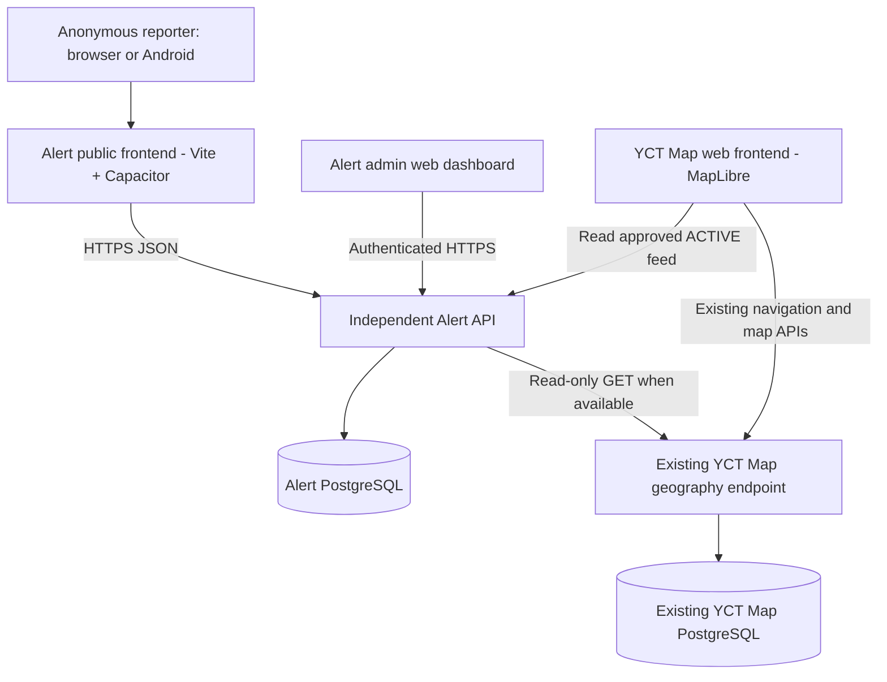

# 02 — Architecture and Service Boundaries

## Design objectives

Independent failure domains, small API contracts, predictable incident state ownership, no duplicate cross-product authentication, and browser/Android frontend reuse.

## Logical diagram



## Service responsibilities

| Component | Owns | Must not own |
|---|---|---|
| Alert public frontend | Forms, UI validation, consent, location adapters, receipts | Admin permissions or incident truth |
| Alert API | Server validation, idempotency, matching, workflow, safe publishing | YCT Map routing or location editing |
| Alert database | Reports, incidents, links, admin users, audit rows, outbox (if later) | YCT Map tables |
| Admin web UI | Review experience and workflow forms | Direct DB writes or client-authoritative state |
| YCT Map | Canonical place IDs, map assets, navigation/routing | Incident moderation |
| Map incident adapter | Independent retrieval and layers for approved incidents | Route algorithm changes |

## Recommended technical starting stack — PROVISIONAL

- Workspace: TypeScript monorepo with npm workspaces and lockfile.
- Public UI: Vite + React/TypeScript with accessible components; web output in `dist`.
- Native wrapper: Capacitor 8 (verify current compatibility with installed Node/Android SDK). Begin Android during week one.
- Admin: separate Vite React/TypeScript app, browser-delivered.
- Server: Fastify/TypeScript API (or equivalent chosen by owner) with JSON schema validation, OpenAPI, PostgreSQL transactions, migrations and typed DB access.
- Persistence: dedicated managed PostgreSQL; ORM/query-builder must support transactions, unique constraints and explicit row locking.
- Contracts: OpenAPI 3.1 and shared Zod/JSON Schema types generated/validated in CI.

**These libraries have not been approved by the owner.** At Gate G0 record the stack as an ADR and verify versions, compatibility and free-tier constraints. Reject framework proliferation.

## Example new repository layout

```text
YCT-Alert/
  AGENTS.md
  README.md
  apps/
    public/       # installable web + Capacitor bundle
    admin/        # browser admin dashboard
  services/
    api/          # HTTP service, auth, matching, database
  packages/
    contracts/    # OpenAPI and shared schemas
  docs/           # this authoritative plan
  scripts/        # safe local tooling only
  .env.example
```

## Cross-service communication

- YCT Map currently **reportedly** offers `GET /api/locations/` (GeoJSON FeatureCollection).
- Alert should read from it **on demand**, optionally with a short-lived **non-authoritative** cache; do not block submission on Map startup.
- Alert should expose `GET /api/v1/incidents/active/` with explicit freshness metadata and safe public fields.
- Map should load incidents separately from navigation. If fetch fails, show stale/unavailable status where incident visibility is expected; never imply there are zero incidents just because fetch failed.
- Avoid a Map→Alert→Map request cycle during page initialization: fetch incidents and base geography independently.
- CORS and origin allowlist must be configured for real production domains only after chosen; Capacitor native origins may differ from browser origin and require validation.

## Fault-tolerance boundaries

1. Map cold start/down → incident location can be manual or GPS-based, without using Map DB.
2. Alert down → Map location, routing, GPS and editors unaffected; hide/flag stale incidents, not route engine.
3. Partial Alert report POST failure → no false `received` state; idempotent recovery.
4. Admin dashboard down → public reporting can still be received; no assumed immediate response.
5. Native plugin unavailable → use web fallback when safe and supported; manual location always works.

## Security boundary

Browser/Android clients are untrusted. API performs all validation, moderation authorization and published-field filtering. Admin cookies/tokens never shared with YCT Map. No hardcoded password, raw secret, or signing key in source, example logs or mobile build.

## Observability

Request IDs, idempotency outcomes, API health, database connectivity, incident-state changes, stale feed age, failed location lookup, admin assignment actions. Do not record private descriptions, phone numbers or exact reporter GPS in application logs.
