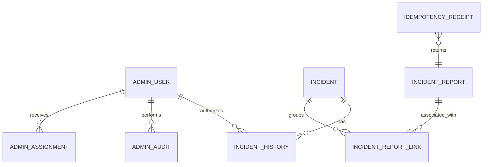

# 05 — Proposed Relational Data Model

**Status:** Proposed logical schema. Exact SQL types and migrations must be reviewed and approved before implementation.

## Entity diagram

Prefer a **join table** for report–incident association with current link/unlink history: an accepted report ordinarily belongs to at most one current incident; historical reassignment survives for audit. Alternatively enforce nullable `incident_id` on report with a separate merge-history table. Decide before migrations.

## Data tables

### `incident_reports`

- `id UUID PK` — server-generated opaque ID.
- `submitted_at TIMESTAMPTZ` — UTC server time.
- `category_code TEXT NOT NULL` — taxonomy version tracked.
- `description TEXT NOT NULL` — private raw report, strictly length-limited.
- `incident_lat`, `incident_lon` nullable decimal/numeric — where event occurred; neither is automatically the reporter's location.
- `location_text TEXT` nullable — user-provided landmark/location, may substitute for coordinates.
- `yct_map_place_id UUID NULL` — **external reference** only, not cross-DB FK.
- `place_name_snapshot TEXT` nullable — context at submission; may become outdated.
- `location_source ENUM('MANUAL_POINT','MAP_PLACE','DEVICE_GPS','TEXT_ONLY')`.
- `location_resolution_status ENUM('RESOLVED','NEEDS_REVIEW')`.
- `optional_contact` nullable encrypted/appropriately protected field only if owner approves collection; not V1 default.
- `receipt_id TEXT UNIQUE` — random opaque public-facing receipt.
- `is_test BOOLEAN` — required for dev/test, production simulated submissions prohibited by release procedure.
- `validation_metadata JSONB` — strictly enumerated safe metadata; not arbitrary device fingerprint.

**Do not collect:** phone IMEI, persistent device ID, private browser fingerprint or mandatory account identity.

### `incidents`

- `id UUID PK`, `public_id TEXT UNIQUE` opaque, safe to share.
- `status ENUM('PENDING','ACTIVE','RESOLVED','REJECTED')`.
- `category_code`, `safe_public_summary` (nullable until approval), `severity_code` (pending taxonomy decision).
- `display_lat`, `display_lon` nullable safe/public coordinates; may be generalized.
- `first_reported_at`, `last_reported_at`, `created_at`, `activated_at`, `resolved_at`, `updated_at` UTC.
- `reviewed_by_admin_id` nullable, `resolution_reason` nullable private field.
- `row_version INT` or similarly safe optimistic concurrency field.
- `publishable BOOLEAN` derived from state and required public fields, not user provided.
- Denormalized `report_count` optional; if used update transactionally and reconcile regularly.

### `incident_report_links`

- `incident_id FK -> incidents`, `report_id FK -> incident_reports`.
- `linked_at`, `unlinked_at` (nullable), `match_method ENUM('SUGGESTED','ADMIN','CREATION')`.
- `linked_by_admin_id` nullable, `reason_code` and safe audit comments.
- Unique active link per `report_id`; protect against race conditions. Do not delete raw report on split/merge.

### `idempotency_receipts`

- `scope='PUBLIC_REPORT'`, `key_hash`, `request_fingerprint`, `report_id`, `response_code`, `created_at`, `expires_at`.
- Unique `(scope,key_hash)`; never log or expose raw key.
- Same key + same canonical payload returns same receipt; same key + different payload returns `409 IDEMPOTENCY_KEY_REUSED`.
- Expiration TTL **to be decided**, long enough for mobile retries; cleanup may delete only idempotency rows, not reports.

### `admin_users`

- `id UUID PK`, `username` unique case-normalized, password hash (Argon2id or approved hardened equivalent), `is_active`, `protected_owner` boolean, created/updated timestamps.
- `protected_owner` designated via migration/secure bootstrap, not by public registration; username `ALERTadmin` reserved by owner request.
- Optional stronger authentication factor for privileged roles; production release gate.

### `admin_assignments`

- `id`, `admin_user_id`, `role`, `scope`, `starts_at`, `expires_at`, `revoked_at`, `assigned_by`, `revoked_by`, `reason`.
- Student assignment needs identifiable account but **not a compulsory reporter account**.
- Privilege is active only if user active AND assignment active, not expired/revoked.
- Revocation invalidates privileged sessions and tokens promptly.

### `incident_history` and `admin_audit`

Immutable append-only event rows: actor, action, target ID, from/to status, timestamp, reason code, request/correlation ID, policy version. Capture only minimal evidence and no plaintext passwords/secret tokens.

## Database integrity rules

1. Incident activation requires authorized admin action, safe summary and policy-compliant publishable location/visibility.
2. Status changes and audit insertion execute atomically in a DB transaction.
3. Idempotency key uniqueness and report creation are atomic; protect under concurrent requests.
4. Merge/split preserve report identity, report content and audit history.
5. Index `status`, `created_at`, `last_reported_at`, `category_code`, and geographic lookup strategy as workload warrants; do not install PostGIS without a validated need.
6. Validate radius proximity with Haversine/geodesic method using correct latitude/longitude ordering; near equator approximate distances may help filtering but never be authoritative without unit tests.
7. YCT Map ID cannot enforce external FK consistency; missing or archived locations become unresolved with a manual fallback.
8. Define encryption, backups and retention before collecting real sensitive data.

## Minimum migration verification

Test clean DB migration, rollback path, unique constraints, time-zone parsing, nullable location, unauthorized admin edits, concurrent identical submissions, concurrent near-duplicates and case-normalized usernames. Production migration requires approval.
