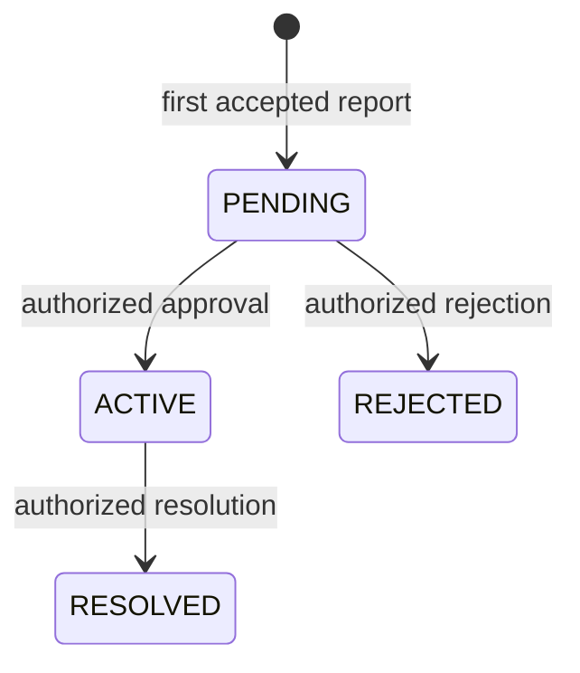

# 06 — Incident Matching, Duplicate Handling and Lifecycle

## Separate two kinds of duplication

**Request repetition** occurs when one submission is retried or Submit is tapped repeatedly. The client reuses the *same idempotency key* and backend returns the *same receipt* (not another raw report).

**Corroboration** occurs when separate submissions might concern the same real event. They remain separate `incident_reports`, and may link to one `incident`. `report_count` is not a count of verified independent witnesses.

## Lifecycle proposal

Do not implement other transitions without a documented decision. Reopening a RESOLVED incident should be a new incident or a separately approved audited transition, not an unguarded status write. Treat received reports and incident `PENDING` as different concepts.

## Matching logic — candidate, not final algorithm

Configuration starting hypothesis: compatible category, geographic separation around **50 metres**, reports within around **15 minutes**, optional same canonical `yct_map_place_id`. These values are trial parameters to calibrate with simulated data and reviewer feedback, **not approved campus policy**.

Suggested pipeline:

1. Server validates report input, normalizes category, preserves original location and assigns receipt.
2. In a concurrency-safe transaction, query recent `PENDING` or active relevant incidents by category/time/nearby location and optional place ID.
3. Generate candidate scores or flags using transparently defined rules. Avoid relying only on matching names, phone numbers, IPs or identical text.
4. If exactly one **high-confidence candidate**, associate report according to the approved policy; otherwise create a new PENDING incident or enter manual review. For safety, bias toward avoiding incorrect merges when the matching signal is ambiguous.
5. Record match basis and audit/association event.
6. Return receipt; do **not** publish incident or imply verification.

A simple V1 may elect **always create a PENDING report, propose candidates to moderators, and defer grouping** until reviewed. That is operationally safer than forced automatic merges and should be considered in the first acceptance review.

## Special cases

| Case | Required behaviour |
|---|---|
| Two fire reports same place/time | Preserve two reports; suggest same incident |
| Fire and medical event near same building | Do not assume identical incident; review separately |
| Same submit retried after timeout | Idempotent same receipt, no extra report |
| Two users submit at identical moment | Unique constraints/transactions prevent duplicate incident races or preserve ambiguity for admin |
| Same category but 100m apart | Do not merge purely by category |
| No coordinates, common landmark only | Lower confidence; allow manual association |
| Old resolved incident, new report | Do not silently reopen; create/review new pending incident |
| Existing incorrect merge | Admin splits safely; raw reports survive |
| Multiple reports of same event across a day | Time window configurable; admin can manually link with reason |

## Moderation and publishing

- Only authorized admin can `activate`, `reject` or `resolve`.
- Approval records admin ID/time and a **reviewed safe public summary**. It is publication approval, **not independent on-scene confirmation**, unless a verified evidence policy is adopted.
- No automated `ACTIVE` from corroboration count, AI confidence, GPS radius or a push notification.
- Admin interface must show location-source confidence and ambiguity, not a fake exact point.
- Public feed excludes missing/sensitive positions where no safe point is available.

## Public state and report state are distinct

`RECEIVED` belongs to **a request receipt**; `PENDING/ACTIVE/RESOLVED/REJECTED` belong to **incidents**. A reporter receiving `202 Accepted` does not necessarily receive a public incident ID or verified status.

## Configuration policy

Set time/radius thresholds, category compatibility and false-merge procedures in reviewed configuration, not hard-coded client constants. Log config version with matching decisions. Escalate safety-impacting policy changes to super admin and owner approval.
